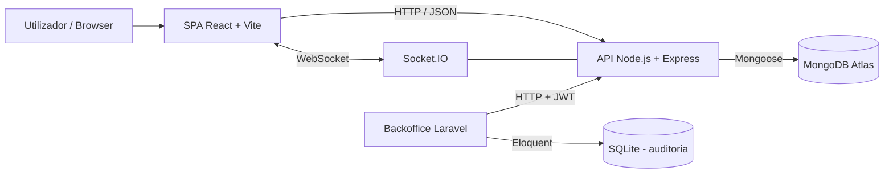

# Do Campo à Mesa

Plataforma web para comercialização de produtos locais, gestão de encomendas e leilões em tempo real.

**Unidade Curricular:** Desenvolvimento Web e para a Cloud  
**Curso:** Mestrado em Engenharia Informática  
**Autor:** Francisco Oliveira Matos — Nº 31406  
**Docente:** Professor Manuel Carvalho  
**Ano letivo:** 2026/2027

---

## 1. Visão geral

O **Do Campo à Mesa** é uma aplicação web full-stack concebida para aproximar produtores locais e consumidores através de um catálogo de produtos, páginas públicas de produtor, encomendas e leilões em direto.

A solução foi construída como uma **Single Page Application (SPA)** em React, suportada por uma **API REST em Node.js/Express**, persistência em **MongoDB Atlas** e comunicação bidirecional através de **Socket.IO**. O sistema distingue quatro perfis funcionais — visitante, comprador, produtor e administrador — e aplica regras de autorização específicas a cada um.

Para além da aplicação principal, foi desenvolvido um **backoffice administrativo em Laravel**, como componente de valorização, seguindo o padrão MVC, com vistas Blade e utilização de Eloquent para auditoria das ações administrativas.

O projeto foi validado com testes automáticos de ponta a ponta sobre a API e os sockets. A execução final terminou com:

```text
58 / 58 verificações a passar.
```

---

## 2. Principais funcionalidades

### Visitante

- consulta do catálogo de produtos;
- pesquisa textual por produto/produtor;
- filtros por categoria, produtor, localidade, época, preço máximo e produção biológica;
- ordenação de resultados;
- página individual de produto;
- páginas públicas dos produtores;
- consulta de localização e avaliações dos produtores;
- consulta dos leilões disponíveis;
- acesso ao login/registo quando pretende efetuar uma ação autenticada.

### Comprador

- registo e autenticação;
- gestão de carrinho;
- alteração de quantidades e remoção de produtos;
- escolha entre levantamento no produtor e entrega ao domicílio;
- criação e consulta de encomendas;
- acompanhamento do estado da encomenda em tempo real;
- avaliação de produtos após entrega;
- avaliação do produtor após entrega;
- denúncia de avaliações para moderação;
- participação em leilões em direto;
- receção de notificações de atualização e de vitória em leilões.

### Produtor

- registo sujeito a validação administrativa;
- definição da localização da exploração durante o registo, através da geolocalização do navegador ou da introdução manual de coordenadas;
- apresentação da localização num mapa OpenStreetMap na página pública, após aprovação administrativa;
- edição da página pública;
- gestão de produtos (criação, edição e remoção);
- gestão de stock;
- indicadores de vendas, encomendas, avaliações e leilões;
- processamento das encomendas através dos estados:
  - `pendente`;
  - `confirmada`;
  - `pronta`;
  - `entregue`;
- criação de leilões;
- acompanhamento de leilões ativos.

### Administrador

- autenticação com papel `admin`;
- consulta de estatísticas globais;
- validação/rejeição de novos produtores;
- acompanhamento de leilões ativos;
- listagem de avaliações denunciadas;
- ocultação/restauro de avaliações;
- acesso ao backoffice Laravel adicional.

---

## 3. Arquitetura

O repositório contém três aplicações independentes:

```text
do-campo-a-mesa/
├── api/          # API REST, Socket.IO, MongoDB/Mongoose e Swagger
├── web/          # SPA React/Vite
├── backoffice/   # Backoffice Laravel MVC + Blade + Eloquent
└── README.md
```

### Arquitetura lógica



A SPA não comunica diretamente com a base de dados. Todas as regras de negócio são validadas pela API. A ligação Socket.IO utiliza a mesma identidade autenticada através de JWT.

O backoffice Laravel também **consome a API Node**, mantendo o MongoDB como fonte de verdade dos dados funcionais. A base SQLite do Laravel é utilizada apenas para auditoria administrativa.

---

## 4. Tecnologias utilizadas

| Área | Tecnologia | Utilização |
|---|---|---|
| Frontend | React 18 | SPA, componentes e páginas |
| Build frontend | Vite 6.4.6 | servidor de desenvolvimento e build |
| Routing | React Router | navegação e rotas protegidas |
| UI | Bootstrap 5 | grelha e componentes base |
| Estilos | SASS/SCSS | variáveis, mixins e estilos próprios |
| Backend | Node.js | runtime da API |
| API | Express 4 | endpoints REST e middleware |
| Tempo real | Socket.IO 4 | leilões e notificações |
| Base de dados | MongoDB Atlas | persistência principal |
| ODM | Mongoose 8 | schemas, validação e queries |
| Autenticação | JWT | sessão stateless na aplicação principal |
| Passwords | bcryptjs | hash e validação de passwords |
| Documentação | OpenAPI 3 + Swagger UI | contrato e exploração da API |
| Uploads | Multer | receção de imagens |
| Imagens em produção | Supabase Storage | armazenamento dos produtos |
| Backoffice | Laravel 13 | componente administrativo adicional |
| Views Laravel | Blade | interface do backoffice |
| Auditoria | Eloquent + SQLite | registo de ações administrativas |

---

## 5. Frontend

A interface segue uma abordagem **Mobile First**, com adaptação progressiva a ecrãs maiores e utilização dos breakpoints previstos no trabalho.

### Estrutura relevante

```text
web/src/
├── api/
│   └── client.js
├── components/
├── context/
│   ├── AuthContext.jsx
│   ├── CarrinhoContext.jsx
│   └── SocketContext.jsx
├── hooks/
├── pages/
│   ├── admin/
│   └── produtor/
├── styles/
├── App.jsx
└── main.jsx
```

### Estado global

- **AuthContext** — utilizador autenticado e token JWT;
- **CarrinhoContext** — itens e quantidades do carrinho;
- **SocketContext** — ligação Socket.IO reutilizada pela aplicação.

### Routing

As rotas públicas incluem, entre outras:

- `/` — catálogo;
- `/produtos/:id` — detalhe de produto;
- `/produtores` — produtores;
- `/produtores/:id` — página pública do produtor;
- `/leiloes` — listagem de leilões;
- `/login`;
- `/registo`.

As áreas privadas são protegidas por papel através de `RotaProtegida`.

### Acessibilidade

Foram aplicadas medidas como:

- HTML semântico;
- ligação “Saltar para o conteúdo”;
- textos alternativos em imagens;
- associação de labels aos controlos;
- utilização de `aria-live`, `role="status"` e `role="alert"` em feedback dinâmico;
- estados visuais claros para ações e progresso de encomendas.

---

## 6. API REST

A API encontra-se em `api/` e é executada, por omissão, na porta **3000**.

Principais grupos de recursos:

```text
/api/auth
/api/products
/api/producers
/api/orders
/api/auctions
/api/reviews
/api/admin
```

### Códigos HTTP utilizados

- `200` — consulta/alteração bem-sucedida;
- `201` — recurso criado;
- `204` — operação concluída sem conteúdo de resposta;
- `400` — dados inválidos;
- `401` — autenticação inválida/ausente;
- `403` — utilizador autenticado sem permissão;
- `404` — recurso inexistente ou inacessível;
- `409` — conflito de domínio (por exemplo, stock insuficiente ou estado inválido).

### Swagger / OpenAPI

Com a API a correr localmente:

```text
http://localhost:3000/api-docs
```

Health check:

```text
http://localhost:3000/api/health
```

Resposta esperada:

```json
{
  "estado": "ok"
}
```

---

## 7. Modelo de dados

A aplicação utiliza as seguintes coleções principais:

| Coleção | Função |
|---|---|
| `users` | compradores, produtores e administradores |
| `products` | catálogo de produtos e stock |
| `orders` | encomendas e respetivas linhas |
| `auctions` | leilões e licitação atual |
| `bids` | histórico de licitações |
| `reviews` | avaliações de produtos/produtores e moderação |

### Embedding e linking

A modelação combina referências entre entidades independentes com dados embebidos quando existe vantagem de consistência ou de preservação histórica.

Exemplos:

- `Product` referencia o respetivo produtor;
- `Review` referencia autor, produtor, produto e encomenda;
- `Order` referencia comprador/produtor, mas contém as linhas embebidas;
- cada linha da encomenda preserva nome, preço unitário, unidade e quantidade observados no momento da compra;
- `Auction` contém a `licitacaoAtual` embebida, permitindo uma atualização atómica.

### Operadores MongoDB utilizados

Entre outros:

- `$regex` / `$options` — pesquisa textual;
- `$lte`, `$gte`, `$lt`, `$gt` — filtros numéricos/temporais;
- `$in` — filtros por conjunto de valores;
- `$inc` — incrementos/decrementos atómicos;
- `$set` — atualização de campos;
- `sort()` e `limit()` — ordenação e limitação de resultados.

---

## 8. Encomendas e stock

A criação de uma encomenda reserva stock de forma condicionada.

Não é utilizado apenas o padrão:

```text
ler stock -> verificar -> atualizar
```

porque dois pedidos concorrentes poderiam observar o mesmo stock.

Cada linha é atualizada garantindo que existe quantidade suficiente. Se uma linha posterior da mesma encomenda falhar, as quantidades previamente reservadas são repostas antes de devolver o erro ao cliente.

Este comportamento está coberto pelos testes automáticos, incluindo:

- reserva válida (`12 -> 10`);
- stock insuficiente (`409`);
- rollback de uma linha previamente reservada quando outra falha.

---

## 9. Avaliações e moderação

Após uma encomenda ser marcada como `entregue`, o comprador pode avaliar:

- o produto;
- o produtor.

A API impede avaliações repetidas da mesma encomenda/produto.

Os utilizadores autenticados podem denunciar uma avaliação. O administrador recebe essa informação no painel e pode:

- **ocultar** a avaliação;
- **restaurar** a avaliação.

O conteúdo ocultado deixa de ser devolvido na área pública, mas o documento é preservado para moderação e eventual restauro.

---

## 10. Leilões em tempo real

Os leilões utilizam Socket.IO para:

- entrada/saída de salas;
- sincronização do estado inicial;
- presença;
- novas licitações;
- rejeição de licitações inválidas;
- fecho do leilão;
- notificação do vencedor;
- atualização do painel administrativo.

### Consistência de licitações concorrentes

O ponto crítico é impedir que duas licitações simultâneas sobre o mesmo valor sejam ambas aceites.

A solução utiliza `findOneAndUpdate` com uma condição sobre o valor atual do próprio documento `Auction`:

```js
const leilao = await Auction.findOneAndUpdate(
  {
    _id: leilaoId,
    estado: 'ativo',
    terminaEm: { $gt: agora },
    'licitacaoAtual.valor': {
      $lte: limiteAnterior
    }
  },
  {
    $set: {
      licitacaoAtual: {
        valor: valorLicitacao,
        comprador: socket.user.id,
        nome: socket.user.nome,
        em: agora
      }
    },
    $inc: {
      numLicitacoes: 1
    }
  },
  {
    new: true,
    runValidators: true
  }
);
```

Quando dois compradores submetem simultaneamente **105 €**, apenas a primeira atualização consegue satisfazer o filtro. A segunda já encontra um valor diferente e é recusada.

O teste automático confirma simultaneamente que:

1. só uma das duas respostas é aceite;
2. existe apenas **uma** licitação de 105 € no histórico.

### Fecho do leilão

Quando o prazo termina:

1. o estado passa de `ativo` para `terminado`;
2. é determinado o vencedor;
3. é criada uma encomenda `confirmada` com origem `leilao`;
4. a encomenda é associada ao leilão;
5. o vencedor recebe a notificação `leilao-ganho`.

Um comprador não vencedor não consegue consultar essa encomenda.

---

## 11. Autenticação e segurança

### JWT

Após login, a API devolve um token JWT e os dados públicos do utilizador. O token é enviado em:

```text
Authorization: Bearer <token>
```

A ligação Socket.IO também é autenticada.

### Passwords

As passwords são guardadas exclusivamente como hash `bcrypt`.

O campo `passwordHash` não é devolvido nas consultas normais do Mongoose.

### Autorização

A segurança é aplicada no backend, mesmo quando a interface já esconde uma determinada ação.

Exemplos testados:

- comprador não acede ao painel administrativo (`403`);
- produtor ainda não validado não pode publicar produtos (`403`);
- outro produtor não pode editar um produto alheio (`404`);
- token de socket inválido é recusado.

### Variáveis sensíveis

Os ficheiros `.env` não são versionados. Apenas `.env.example` deve ser enviado para o Git.

---

## 12. Backoffice Laravel

Foi desenvolvido um backoffice adicional na pasta `backoffice/`.

Características:

- Laravel 13;
- arquitetura MVC;
- interface em Blade;
- autenticação administrativa através da API Node;
- token guardado em sessão Laravel;
- dashboard com:
  - estatísticas;
  - produtores pendentes;
  - avaliações denunciadas;
  - leilões ativos;
  - histórico de ações administrativas;
- aprovação/rejeição de produtores;
- ocultação/restauro de avaliações.

### Eloquent e auditoria

Os dados principais continuam no MongoDB. Para demonstrar uma utilização real de Eloquent sem duplicar a base de negócio, foi criada uma base SQLite local para auditoria.

O modelo `AdminAudit` regista:

- administrador;
- email;
- ação;
- tipo de alvo;
- identificador do alvo;
- detalhes em JSON;
- timestamps.

---

## 13. Instalação e execução

### 13.1 Pré-requisitos

Para a aplicação principal:

- Git;
- Node.js 20 ou superior;
- npm;
- acesso a uma base MongoDB (local ou MongoDB Atlas).

Para o backoffice opcional:

- PHP 8.x;
- Composer;
- extensões PHP necessárias ao Laravel/SQLite.

---

### 13.2 Clonar o repositório

```bash
git clone https://github.com/FranciscoOMatos/do-campo-a-mesa.git
cd do-campo-a-mesa
```

---

### 13.3 Configurar e arrancar a API

```bash
cd api
npm install
```

Criar `.env` a partir do exemplo:

**PowerShell**

```powershell
Copy-Item .env.example .env
```

**Bash/Git Bash**

```bash
cp .env.example .env
```

Configuração base esperada:

```env
PORT=3000
MONGODB_URI=mongodb://localhost:27017/do-campo-a-mesa
JWT_SECRET=trocar-por-um-segredo-longo-e-aleatorio
JWT_EXPIRES_IN=2h
CLIENT_URL=http://localhost:5173
STORAGE_CONN=
STORAGE_CONTAINER=produtos
```

> Para MongoDB Atlas, substituir `MONGODB_URI` pela connection string do cluster.

Gerar um segredo JWT forte, por exemplo:

```bash
node -e "console.log(require('crypto').randomBytes(48).toString('hex'))"
```

Carregar os dados de demonstração:

```bash
npm run seed
```

Arrancar a API em desenvolvimento:

```bash
npm run dev
```

Ou sem nodemon:

```bash
npm start
```

API:

```text
http://localhost:3000
```

Swagger:

```text
http://localhost:3000/api-docs
```

---

### 13.4 Configurar e arrancar o frontend

Num segundo terminal:

```bash
cd web
npm install
```

Criar `.env`:

```env
VITE_API_URL=http://localhost:3000
VITE_USAR_DADOS_SIMULADOS=false
```

Arrancar:

```bash
npm run dev
```

Frontend:

```text
http://localhost:5173
```

Build de produção:

```bash
npm run build
```

---

### 13.5 Arrancar o backoffice Laravel

Garantir primeiro que a API Node está a correr.

```bash
cd backoffice
composer install
npm install
```

Criar `.env`:

```bash
cp .env.example .env
```

No Windows PowerShell:

```powershell
Copy-Item .env.example .env
```

O endereço da API deve estar configurado como:

```env
NODE_API_URL=http://localhost:3000/api
```

Gerar a chave da aplicação:

```bash
php artisan key:generate
```

Criar a base SQLite (se ainda não existir):

**PowerShell**

```powershell
New-Item database/database.sqlite -ItemType File -Force
```

**Bash**

```bash
touch database/database.sqlite
```

Executar as migrations:

```bash
php artisan migrate
```

Build dos assets:

```bash
npm run build
```

Arrancar o servidor Laravel:

```bash
php artisan serve
```

Backoffice:

```text
http://localhost:8000
```

---

## 14. Dados de demonstração

O comando:

```bash
cd api
npm run seed
```

repõe a base de dados configurada em MONGODB_URI num estado conhecido. ATENÇÃO: executar apenas em desenvolvimento ou testes, nunca em produção.

### Credenciais

As credenciais de demonstração estão definidas no ficheiro `api/src/seed/seed.js` e destinam-se apenas ao ambiente local. Não devem ser reutilizadas em produção.

| Papel | Email |
|---|---|
| Administrador | `admin@exemplo.pt` |
| Comprador | `tasca@exemplo.pt` |
| Produtor | `horta@exemplo.pt` |
| Produtor | `mel@exemplo.pt` |
| Produtor | `padaria.minho@exemplo.pt` |
| Produtor | `queijaria.valedolima@exemplo.pt` |
| Produtor | `quinta.valedolima@exemplo.pt` |

O seed final contém:

- 7 utilizadores;
- 5 produtores validados;
- 14 produtos;
- 14 imagens preparadas;
- 1 leilão ativo.

---

## 15. Testes

### Testes E2E da API e Socket.IO

Com a API a correr:

```bash
cd api
npm test
```

Resultado final validado:

```text
58 / 58 verificações a passar.
```

A suite cobre, entre outros:

- health check;
- login e sessão autenticada;
- registo de comprador/produtor;
- validação administrativa;
- autorização por papel;
- CRUD de produtos;
- pesquisa `$regex`;
- filtros `$lte` e ordenação;
- ownership de produtos;
- reserva atómica de stock;
- rollback de stock;
- criação e estados de encomendas;
- notificações de encomenda em tempo real;
- criação e moderação de avaliações;
- denúncia de avaliações;
- autenticação Socket.IO;
- salas de leilão;
- licitações abaixo do mínimo;
- licitações simultâneas;
- consistência do histórico;
- fecho automático;
- identificação/notificação do vencedor;
- criação automática da encomenda do leilão;
- isolamento da encomenda perante compradores não vencedores.

> Os testes criam dados temporários. Para voltar ao cenário de demonstração, executar novamente `npm run seed`.

### Testes Laravel

```bash
cd backoffice
php artisan test
```

Resultado final validado:

```text
3 testes aprovados
4 assertions
```

---

## 16. Cloud

### 16.1 Deployment realizado

A aplicação Do Campo à Mesa encontra-se publicada na cloud, utilizando uma arquitetura que separa o frontend, a API, a base de dados e o armazenamento de imagens.

Os serviços utilizados são:

| Componente | Tecnologia / Serviço | Modelo |
|---|---|---|
| Frontend | React + Vite no Render Static Site | Hosting/PaaS |
| Backend | Node.js + Express no Render Web Service | PaaS |
| Base de dados | MongoDB Atlas | DBaaS |
| Imagens | Supabase Storage | BaaS / Object Storage |
| Backoffice adicional | Laravel, executado localmente | Aplicação local ligada à API cloud |

### 16.2 Endereços públicos

- Website: https://do-campo-a-mesa-web.onrender.com
- API: https://do-campo-a-mesa-api-7hoe.onrender.com
- Health check: https://do-campo-a-mesa-api-7hoe.onrender.com/api/health
- Swagger: https://do-campo-a-mesa-api-7hoe.onrender.com/api-docs

O frontend e a API utilizam HTTPS.

### 16.3 Base de dados e armazenamento

A API publicada utiliza uma base de dados MongoDB Atlas dedicada ao ambiente de deployment, separada da base utilizada no desenvolvimento local.

As imagens dos produtos são armazenadas num bucket público do Supabase Storage, evitando a dependência do sistema de ficheiros temporário do serviço Render.

Foram publicados os ficheiros de imagem dos 14 produtos de demonstração, que podem ser consultados através do catálogo público.

### 16.4 Comunicação em tempo real

Os leilões utilizam Socket.IO para a comunicação entre clientes e servidor.

A comunicação em tempo real foi testada no ambiente publicado, incluindo ligações WebSocket e atualização de licitações entre sessões de navegador diferentes.

### 16.5 Backoffice Laravel

O backoffice administrativo Laravel continua a ser executado localmente.

Através da variável NODE_API_URL, o Laravel pode comunicar com a API publicada no Render, permitindo consultar os mesmos dados do ambiente de produção.

Foram validados o login administrativo, o dashboard, o logout e a proteção de acesso após terminar sessão.

### 16.6 Segurança e validação

A API utiliza autenticação JWT e autorização baseada em papéis.

Foram executados testes de acesso ao endpoint administrativo de estatísticas, com os seguintes resultados:

- Sem autenticação: HTTP 401.
- Produtor autenticado: HTTP 403.
- Administrador autenticado: HTTP 200.

Também foram executados os três testes automatizados existentes no Laravel, com quatro asserções e nenhuma falha.

Estes testes validam os cenários descritos, não constituindo uma auditoria de segurança completa.

### 16.7 Custos e limitações

O deployment utiliza serviços e planos gratuitos, sujeitos às quotas e condições dos respetivos fornecedores.

No plano gratuito do Render, a API pode entrar em suspensão após períodos de inatividade, provocando atrasos no primeiro pedido.

Não foi implementado nem validado auto-scaling. O backoffice Laravel também não foi publicado como serviço independente na cloud.

A solução demonstra a integração entre diferentes serviços cloud, mantendo separados os ambientes de desenvolvimento e produção.

---
## 17. Decisões técnicas relevantes

### Licitações simultâneas

Problema: duas propostas podem chegar praticamente no mesmo instante.

Solução: atualização condicional atómica no documento `Auction` através de `findOneAndUpdate`.

### Reserva de stock

Problema: evitar vender mais stock do que o disponível e evitar reservas parciais quando uma encomenda falha a meio.

Solução: decrementos condicionados + reposição das reservas anteriores em caso de falha.

### Histórico das encomendas

Problema: alterações posteriores de preço/nome do produto não devem alterar compras antigas.

Solução: linhas da encomenda embebem os dados relevantes observados no momento da compra.

### Backoffice

Problema: cumprir a componente Laravel sem criar uma segunda fonte de verdade de negócio.

Solução: Laravel consome a API existente; Eloquent/SQLite é usado exclusivamente para auditoria administrativa.

---

## 18. Limitações e melhorias futuras

- preparar Socket.IO para múltiplas instâncias através de um adaptador partilhado (por exemplo, Redis);
- adicionar estados de análise e resolução às denúncias;
- aumentar a cobertura automatizada do frontend;
- adicionar testes de componentes/interface;
- estudar auto-scaling e custos reais em Cloud.

---

## 19. Processo de desenvolvimento

O trabalho foi desenvolvido de forma incremental, recorrendo a branches e pull requests para funcionalidades relevantes.

Na fase final foram, por exemplo, integradas separadamente:

- backoffice administrativo em Laravel;
- página individual de produto;
- possibilidade de denunciar avaliações.

Antes da preparação dos entregáveis foi efetuada a validação final:

1. `58/58` testes E2E;
2. novo `seed` para remover dados temporários;
3. `npm run build` do frontend concluído;
4. `php artisan test` concluído;
5. repositório `main` sincronizado e sem alterações pendentes.

---

## 20. Utilização de Inteligência Artificial

Foi utilizada a ferramenta ChatGPT (OpenAI) como apoio ao desenvolvimento e documentação, nomeadamente para:

- clarificação de requisitos;
- sugestão de passos incrementais;
- diagnóstico de erros;
- revisão de código;
- apoio à criação e extensão dos testes;
- discussão de decisões arquiteturais;
- estruturação e revisão da documentação.

As alterações sugeridas foram executadas e verificadas pelo autor. A responsabilidade pelas decisões técnicas, testes, validação funcional e versão final permaneceu do autor do projeto.

---

## 21. Autor

**Francisco Oliveira Matos**  
Nº 31406  
Mestrado em Engenharia Informática  
Desenvolvimento Web e para a Cloud — 2026/2027

---

## 22. Atualizações finais (novembro de 2026)

### Validação de produtores

Foi reforçada a proteção das áreas de gestão dos produtores. Após o registo, a conta permanece pendente até à aprovação administrativa.

Enquanto aguarda aprovação, o produtor visualiza um ecrã específico, com a possibilidade de verificar novamente o estado da conta.

Esta melhoria foi integrada através do Pull Request #25.

### Localização geográfica dos produtores

Foi melhorado o registo de produtores para permitir definir a localização da exploração agrícola através de latitude e longitude.

O formulário disponibiliza duas opções: obter as coordenadas através da geolocalização do navegador, mediante autorização do utilizador, ou introduzi-las manualmente.

As coordenadas são validadas pela API e guardadas no MongoDB. Após aprovação administrativa, a localização é apresentada num mapa OpenStreetMap na página pública do produtor. A localização também pode ser alterada posteriormente na edição do perfil.

A melhoria foi validada localmente através do registo de um novo produtor, aprovação administrativa e confirmação do mapa na respetiva página pública.

Foram novamente executadas as 58 verificações E2E, todas aprovadas. O frontend foi compilado com sucesso e a nova versão do formulário foi confirmada no Render.

Esta funcionalidade foi integrada através do Pull Request #28.

### Sistema de denúncias de avaliações

O sistema de denúncias foi melhorado com:

- Formulário com motivo obrigatório e descrição opcional;
- Quatro motivos disponíveis: linguagem ofensiva, informação falsa, spam e outro motivo;
- Nova coleção MongoDB `reviewdenuncias`;
- Registo do utilizador, avaliação, motivo, descrição e data;
- Prevenção de denúncias da própria avaliação (HTTP 403);
- Prevenção de denúncias duplicadas (HTTP 409);
- Persistência do estado "Denunciada" após atualizar a página;
- Transações MongoDB para garantir a consistência do contador;
- Consulta dos motivos e descrições no painel administrativo;
- Ocultação e restauro das avaliações denunciadas.

Esta melhoria foi integrada através do Pull Request #26.

### Testes e validação final

A versão final foi validada com 58 verificações E2E aprovadas.

Os testes incluem autenticação, autorização, gestão de produtos, encomendas, stock, notificações Socket.IO, avaliações, denúncias e leilões.

Foram também testados pedidos de denúncia simultâneos, confirmando que apenas uma denúncia é registada por utilizador e avaliação.

O frontend foi compilado com sucesso através de `npm run build`.

O backoffice Laravel foi validado com 3 testes e 4 asserções aprovados.

### Publicação na cloud

A aplicação foi publicada com a seguinte arquitetura:

- Frontend React/Vite: Render Static Site;
- API Node.js/Express: Render Web Service;
- Base de dados: MongoDB Atlas;
- Imagens: Supabase Storage;
- Backoffice Laravel: execução local com acesso à API publicada.

Foram confirmados os deployments da API e do frontend no Render com o commit `7e8a001`, resultante do Pull Request #28, que integra a funcionalidade de localização dos produtores. Ambos os serviços apresentaram o estado Live.

A comunicação em tempo real foi demonstrada entre diferentes sessões do navegador, incluindo notificações de encomendas e licitações.

### Melhorias futuras

Permanecem como possibilidades de evolução:

- Adicionar estados de análise e resolução às denúncias;
- Aumentar a cobertura de testes automatizados do frontend;
- Melhorar a monitorização e o desempenho;
- Preparar a comunicação Socket.IO para múltiplas instâncias;
- Estudar escalabilidade e custos de operação na cloud.
